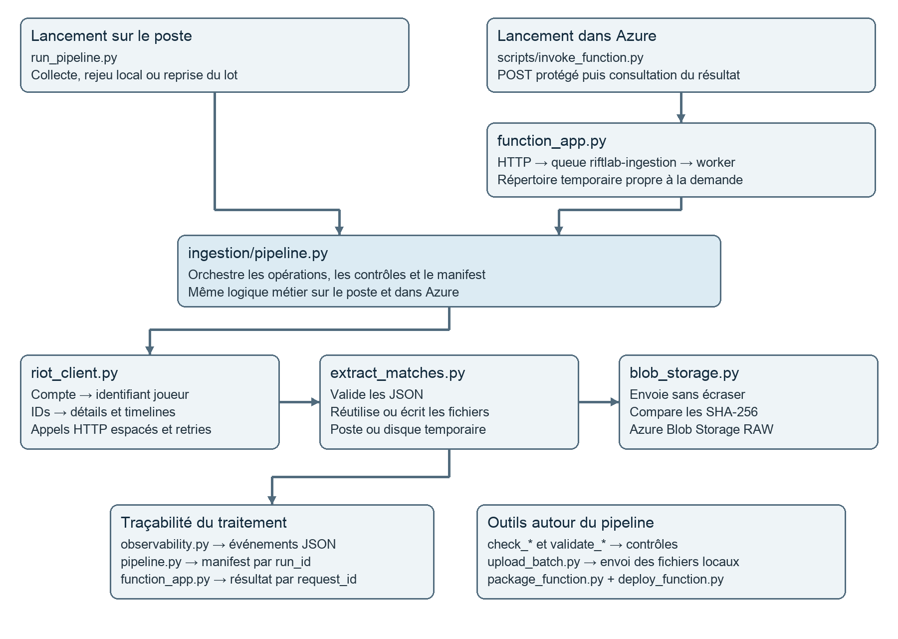

# Point d’étape sur les scripts de Riftlab AI

22 octobre 2026

Inventaire des 21 fichiers Python. Collecte Riot Games, stockage Azure et exécution Azure Functions.

## Les points de lancement locaux

Ces fichiers lancent une action complète. Les modules du dossier ingestion fournissent les fonctions qu’ils utilisent.

### run_extraction.py

**Ce qu’il fait** : Charge la configuration, retrouve le joueur, découvre jusqu’à 50 matchs Solo/Duo et sauvegarde les détails et timelines dans data/. Réutilise les JSON déjà valides et affiche un bilan.

**Pourquoi il le fait** : Constituer un premier jeu de données local et isoler la collecte Riot du stockage cloud.

**Utilisation** : uv run python run_extraction.py
Limite fixée dans MAX_MATCHES. Aucun upload Azure ni manifest de pipeline.

### run_pipeline.py

**Ce qu’il fait** : Lance le pipeline complet, un rejeu des IDs locaux avec --local ou la reprise des IDs d’un ancien manifest avec --resume-manifest. Retourne 0 uniquement en cas de SUCCESS.

**Pourquoi il le fait** : Offrir un point d’entrée unique pour collecter, envoyer, vérifier et reprendre un lot avec un bilan exploitable.

**Utilisation** : uv run python run_pipeline.py --max-matches 3
uv run python run_pipeline.py --local
uv run python run_pipeline.py --resume-manifest data/manifests/<run_id>/manifest.json

### ingestion/riot_client.py

**Ce qu’il fait** : Encapsule les appels Riot : compte, pages d’IDs, détails et timelines. Espace les requêtes de 1,5 seconde minimum et tente jusqu’à cinq appels sur certaines erreurs temporaires ou réseau.

**Pourquoi il le fait** : Centraliser l’authentification et les reprises HTTP pour limiter les échecs transitoires et respecter le débit côté client.

**Utilisation** : Module importé par la collecte et les diagnostics. Les erreurs 401 et 403 ne sont pas retentées. La limite est propre à chaque client, pas partagée entre instances.

### ingestion/extract_matches.py

**Ce qu’il fait** : Vérifie le matchId et la présence de participants ou de frames non vides. Réutilise un fichier valide ; sinon récupère, valide puis écrit le JSON via un fichier temporaire et un remplacement atomique.

**Pourquoi il le fait** : Éviter les téléchargements inutiles, rejeter les réponses manifestement invalides et empêcher qu’une écriture interrompue laisse un JSON partiel.

**Utilisation** : Module réutilisable. Validation minimale, sans contrôle exhaustif du schéma Riot. En mode local, un fichier absent ou invalide produit un échec.

## Le cœur du pipeline

Ces modules portent la logique commune aux exécutions locales et cloud. Ils ne se lancent pas seuls.

### ingestion/pipeline.py

**Ce qu’il fait** : Déduplique et vérifie les IDs, traite chaque paire match et timeline, appelle l’extraction, l’upload et la comparaison SHA-256. Crée un run_id, des événements et un manifest local réécrit après chaque opération, puis publié et relu dans Azure.

**Pourquoi il le fait** : Rendre chaque lot traçable et reprenable. On peut savoir ce qui a été écrit, ignoré, échoué ou laissé non traité, sans confondre succès partiel et succès complet.

**Utilisation** : Appelé par run_pipeline.py et le worker cloud. Statuts finaux : SUCCESS, PARTIAL_SUCCESS ou FAILED. Un Ctrl+C est pris en compte ; un arrêt brutal peut laisser RUNNING dans le checkpoint local.

### ingestion/blob_storage.py

**Ce qu’il fait** : Construit le client du conteneur Azure avec AzureCliCredential sur le poste ou ManagedIdentityCredential dans Functions. Crée les blobs sans écrasement. Si un blob existe, vérifie son SHA-256 ; signale un contenu différent. Expose aussi une vérification explicite.

**Pourquoi il le fait** : Préserver les données déjà déposées et permettre des relances sans doublon. Comparer les octets prouve que le fichier distant correspond au fichier local.

**Utilisation** : Classe BlobStorage importée par les outils et le pipeline. Une création seule par upload_file ne relit pas automatiquement le nouveau blob ; le pipeline appelle ensuite verify_file.

### ingestion/observability.py

**Ce qu’il fait** : Émet des événements JSON horodatés avec un run_id et les champs fournis par l’appelant. Le pipeline y consigne les opérations, durées, retries et résultats sans transmettre les payloads ou les messages détaillés d’exception.

**Pourquoi il le fait** : Rapprocher les événements d’une même exécution et diagnostiquer ses échecs sur le poste ou dans Application Insights.

**Utilisation** : Fonction emit utilisée par le client Riot, le pipeline et le worker. La discrétion des logs dépend aussi des champs que transmettent les appelants.

### ingestion/__init__.py

**Ce qu’il fait** : Fichier vide qui marque ingestion comme paquet Python.

**Pourquoi il le fait** : Organiser les imports des modules métier et leur inclusion dans le package cloud.

**Utilisation** : Aucune commande à exécuter et aucun traitement de données.

## Les diagnostics et le transfert local

Ces outils servent à vérifier une connexion, envoyer un lot déjà extrait ou comparer le stockage distant aux fichiers du poste.

### scripts/check_riot_connection.py

**Ce qu’il fait** : Résout le compte Riot, demande jusqu’à cinq IDs puis lit le premier match et sa timeline. Affiche le nombre d’IDs, l’ID du match, les participants et les frames.

**Pourquoi il le fait** : Vérifier rapidement la clé Riot, le compte et les endpoints nécessaires avant une collecte plus longue.

**Utilisation** : uv run python -m scripts.check_riot_connection
Lit Riot ; ne sauvegarde pas les payloads.

### scripts/check_blob_storage.py

**Ce qu’il fait** : Tente l’envoi du fichier local data/matches/EUW1_8019593098.json vers le blob correspondant. Affiche s’il a été créé ou s’il existait déjà et était identique.

**Pourquoi il le fait** : Valider le chemin d’écriture Azure sur un seul fichier avant un transfert de lot.

**Utilisation** : uv run python -m scripts.check_blob_storage
Ce diagnostic écrit dans Azure. Il exige le fichier dont l’ID est codé dans le script.

### scripts/upload_batch.py

**Ce qu’il fait** : Parcourt les JSON locaux de matches et timelines, refuse les fichiers invalides puis envoie chaque objet valide. Compte uploaded, skipped, invalid et failed ; retourne 1 en cas d’invalidité ou d’échec.

**Pourquoi il le fait** : Transférer un jeu de données déjà extrait sans rappeler Riot, tout en permettant une relance qui préserve les blobs existants.

**Utilisation** : uv run python -m scripts.upload_batch
Ne crée pas de manifest de pipeline. Un blob déjà présent est comparé avant d’être ignoré.

### scripts/validate_blob_storage.py

**Ce qu’il fait** : Lit les inventaires distants, vérifie l’absence d’accès public au conteneur, les JSON locaux, l’appariement match et timeline, les objets manquants ou supplémentaires et les SHA-256. Écrit un rapport local.

**Pourquoi il le fait** : Apporter une preuve de correspondance entre le lot local et les préfixes matches/ et timelines/ dans Azure.

**Utilisation** : uv run python -m scripts.validate_blob_storage --report data/validation/azure_storage_validation.json
Ne modifie pas Azure. Des objets créés uniquement dans le cloud sont signalés comme supplémentaires ; ce constat ne prouve pas une corruption.

## Les scripts pour Azure Functions

Le cloud ajoute un déclenchement HTTP et une file de messages. Le traitement des données reste dans le pipeline commun.

### function_app.py

**Ce qu’il fait** : Expose POST /api/ingestion pour accepter une demande de 1 à 50 matchs et l’inscrire dans la queue. ingest_worker lance le pipeline dans un répertoire temporaire puis publie requests/<request_id>.json. GET /api/ingestion/{request_id} lit ce résultat.

**Pourquoi il le fait** : Déclencher une collecte à distance sans bloquer la requête HTTP pendant toute la collecte et relier la demande à son run_id.

**Utilisation** : Chargé par Azure Functions. Routes protégées par clé. Une demande déjà terminée n’est pas retraitée lors d’une nouvelle livraison. Un ID inconnu et une demande en attente renvoient tous deux HTTP 202.

### scripts/package_function.py

**Ce qu’il fait** : Construit un ZIP par liste explicite : function_app.py, host.json, requirements.txt et les six fichiers Python de ingestion/. Exclut ainsi .env, données, tests et environnement local.

**Pourquoi il le fait** : Fournir un paquet de déploiement limité au runtime et éviter d’y embarquer les secrets ou les données du poste.

**Utilisation** : uv run python -m scripts.package_function
ZIP par défaut : /tmp/riftlab-function.zip.

### scripts/deploy_function.py

**Ce qu’il fait** : Via Azure CLI, crée si nécessaire le stockage interne et la Function App Flex Python 3.12 avec sa supervision. Configure l’identité managée, attribue le rôle Blob au conteneur RAW, transfère les paramètres, crée le ZIP et déploie avec compilation distante.

**Pourquoi il le fait** : Reproduire le déploiement cloud et donner au code métier l’accès au stockage RAW sans utiliser de clé de stockage dans ce code.

**Utilisation** : uv run python -m scripts.deploy_function --app-name <application> --host-storage <stockage-interne>
Modifie les ressources Azure. Groupe et conteneur RAW doivent déjà exister ; requirements.txt doit être à jour.

### scripts/invoke_function.py

**Ce qu’il fait** : Récupère l’adresse et la clé via Azure CLI, vérifie le refus d’un POST sans clé, envoie la demande protégée puis consulte son résultat toutes les cinq secondes. Retourne 0 seulement pour SUCCESS.

**Pourquoi il le fait** : Tester le contrôle d’accès et lancer la collecte cloud depuis une seule commande, sans afficher la clé Functions.

**Utilisation** : uv run python -m scripts.invoke_function --app-name <application> --max-matches 3
Attente de 240 secondes par défaut, ajustable avec --wait-seconds.

## Les scripts de tests

Les cinq fichiers suivants utilisent pytest et des doubles de test pour vérifier les comportements sans lancer une collecte réelle ni déployer Azure.

### tests/test_riot_client.py

**Ce qu’il fait** : Simule des réponses 429 et 503, contrôle le retry et son délai, la corrélation des logs et l’absence de PUUID. Vérifie aussi l’espacement minimal entre requêtes.

**Pourquoi il le fait** : Éviter les régressions sur la gestion du débit et des erreurs temporaires.

**Utilisation** : uv run pytest tests/test_riot_client.py

### tests/test_extract_matches.py

**Ce qu’il fait** : Vérifie un JSON valide, un JSON corrompu, un mauvais matchId et l’écriture atomique avec remplacement et nettoyage des fichiers temporaires.

**Pourquoi il le fait** : Protéger les contrôles de base et la fiabilité de la sauvegarde locale.

**Utilisation** : uv run pytest tests/test_extract_matches.py

### tests/test_blob_storage.py

**Ce qu’il fait** : Simule un blob existant, identique ou différent. Contrôle que l’écriture n’écrase pas ce blob et qu’un skip dépend de la comparaison du contenu.

**Pourquoi il le fait** : Empêcher qu’une relance masque une divergence ou remplace silencieusement une donnée distante.

**Utilisation** : uv run pytest tests/test_blob_storage.py

### tests/test_pipeline.py

**Ce qu’il fait** : Teste le traitement nominal, le rejeu, l’interruption et la reprise, l’arrêt sur accès refusé ou quota épuisé, le rejet de données invalides, les conflits Blob et les échecs de découverte ou de publication du manifest.

**Pourquoi il le fait** : Vérifier que le pipeline conserve un bilan cohérent et ne déclare pas un faux succès lorsqu’une étape échoue.

**Utilisation** : uv run pytest tests/test_pipeline.py

### tests/test_function_app.py

**Ce qu’il fait** : Teste les demandes invalides, la protection des routes, le déclenchement asynchrone, les résultats corrélés, le répertoire temporaire, l’identité managée, les demandes terminées, le ZIP et l’invocation sans affichage de clé.

**Pourquoi il le fait** : Protéger le contrat HTTP et le passage au cloud tout en vérifiant que le paquet contient uniquement les sources nécessaires.

**Utilisation** : uv run pytest tests/test_function_app.py

## Le bilan et les fichiers de support

Le socle actuel couvre l’ingestion brute Riot vers Azure. Les étapes Snowflake, dbt, Streamlit et GenAI annoncées dans la présentation du dépôt ne sont pas implémentées dans les scripts inventoriés.

### Fichiers de configuration

host.json règle le runtime Functions : délai de dix minutes, traitement de queue par lot de un, une tentative avant la queue poison et journalisation. Cette limite de concurrence vaut par instance, pas pour toute l’application.
.env.example décrit les variables attendues ; .env contient les valeurs locales et ne doit pas être inclus dans le déploiement. Une modification de clé Riot locale doit aussi être transférée dans les paramètres Azure.
pyproject.toml définit Python 3.12, les dépendances et les réglages pytest et Ruff. uv.lock verrouille les versions ; requirements.txt fournit les dépendances au build Azure.
.funcignore filtre les fichiers pour l’outillage Functions ; notre packageur utilise surtout sa propre liste explicite. .pre-commit-config.yaml lance Ruff pour corriger le lint et formater les fichiers Python avant les commits.

### Progression des jalons

La progression fonctionnelle va du diagnostic Riot et de l’extraction locale vers l’upload Azure, puis le contrôle d’intégrité, le pipeline traçable avec reprise et enfin l’exécution cloud asynchrone. Les premiers scripts restent utiles pour isoler une panne ou une étape.

### Résultats consignés au 22 octobre 2026

La recette stockage décrit 50 paires locales et 100 blobs identiques. La recette pipeline décrit un rejeu sans nouvel upload et une découverte Riot réussie après renouvellement de clé. La recette Functions décrit une collecte réelle de trois matchs, six nouveaux blobs, un résultat SUCCESS et 53 paires distantes au total. Elle consigne aussi 31 tests réussis. Ces chiffres correspondent aux recettes enregistrées, pas à une nouvelle mesure du service.

### Limites utiles avant la suite

Aucun déclencheur quotidien n’est activé. Le disque temporaire cloud ne réutilise pas les fichiers du poste et ne constitue pas une reprise durable après arrêt forcé. Garder un seul lot actif tant que le débit Riot n’est pas coordonné entre instances. L’audit local peut signaler les six objets créés uniquement dans Azure. La validation JSON reste minimale.

### Commandes et références

Pour les tests : uv run pytest. Pour une collecte complète : uv run python run_pipeline.py --max-matches 3. Pour rejouer le lot local : uv run python run_pipeline.py --local.
Sources du point d’étape : les 21 fichiers Python, README.md, host.json, pyproject.toml, .pre-commit-config.yaml et les trois recettes docs/validation-stockage-azure.md, docs/validation-pipeline.md et docs/validation-azure-functions.md.
